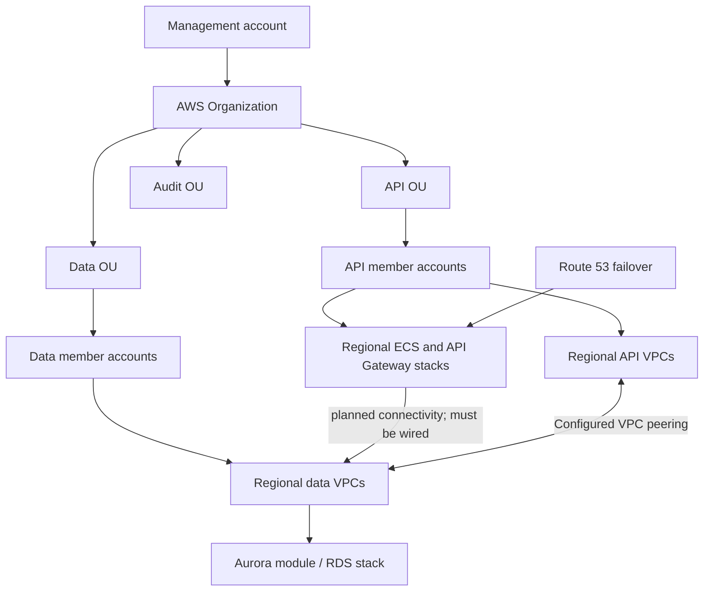
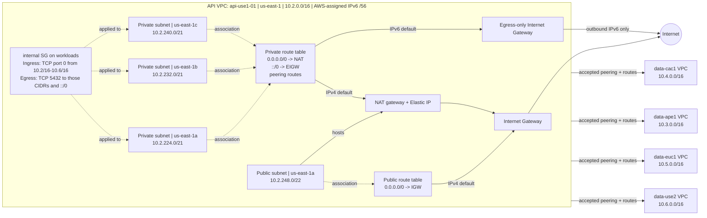
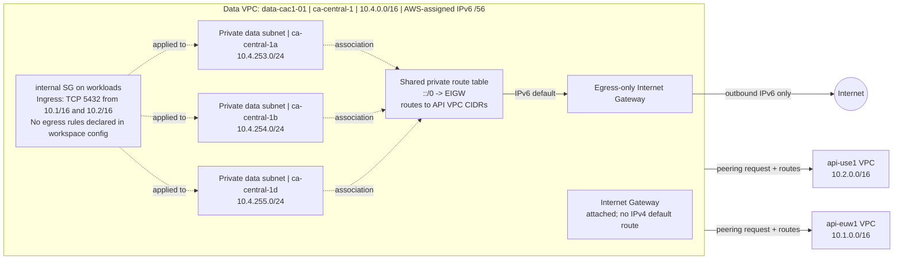
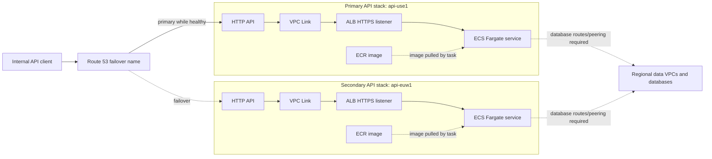

# AWS Infrastructure Design

## Purpose and Scope

This document describes the Terraform-managed AWS infrastructure under `aws/`. It contains three configured Terraform roots and two additional, partially wired infrastructure areas:

- `organization/` manages the AWS Organization, organizational units, member accounts, and per-account region restrictions.
- `vpc/` manages regional VPCs, subnets, route tables, NAT and internet gateways, security groups, and VPC peering.
- `ecs/` defines regional ECS/Fargate services, their VPC networking, load balancer, and an API Gateway HTTP API with a VPC Link.
- `route53/` declares primary/secondary DNS failover records for the regional API endpoints; hosted-zone and health-check wiring is not complete.
- `rds/` contains database workspace configuration and a reusable Aurora cluster module. Its root deployment wiring is currently incomplete; see [Current-State Caveats](#current-state-caveats).

The organization, VPC, ECS, and RDS configuration use Terraform workspaces to select account- and region-specific values. The AWS provider is version 6 across configured roots; most use a `~> 6.0` constraint, while `ecs/` pins version `6.24.0`. The organization, VPC, and ECS roots use an S3 backend configured through workspace HCL files. The Route 53 directory currently has only a record file and no root provider/backend configuration.

## Logical Architecture



The diagram distinguishes the existing VPC-peering network from the newer ECS VPCs. The ECS root currently creates its own VPCs, separate from the VPCs in `vpc/`; the ECS VPCs do not yet have routes/peering to the data VPCs. The Aurora module is reusable, but its current RDS root stack does not yet derive its inputs from the network state and workspace database configuration.

## Organization and Accounts

The [organization stack](organization/organization.tf) creates an AWS Organization with all features enabled and enables selected service integrations and policy types. It creates three organizational units: `api`, `audit`, and `data`. The current account map in [configs.tf](organization/configs.tf) places the API accounts under `api` and data accounts under `data`; the `audit` OU is currently empty.

| Account | OU | Allowed region in account policy |
| --- | --- | --- |
| `api-euw1` | API | `eu-west-1` |
| `api-use1` | API | `us-east-1` |
| `data-ape1` | Data | `ap-east-1` |
| `data-cac1` | Data | `ca-central-1` |
| `data-euc1` | Data | `eu-central-1` |
| `data-use2` | Data | `us-east-2` |

The stack attaches a region-deny service control policy to every listed account. The policy denies requests outside that account's allowed region, subject to a broad list of `NotAction` exceptions for global or account-level services. Account email addresses are required Terraform inputs. The organization resource has `prevent_destroy` enabled.

The organization provider is fixed to `us-east-1`. Default tags identify Terraform as the provisioner and record the selected workspace. The stack exports created account IDs.

## Data Residency

The design intent is to keep each region's event data and database storage in that region. The organization configuration places data accounts in named regions and attaches a region-deny SCP. The data VPCs and database workspaces are also region-specific. These controls support regional separation, but they do not by themselves guarantee data residency: an SCP controls AWS API requests by region, while VPC peering and application requests can still transfer data across regions.

| Data or operation | Residency approach |
| --- | --- |
| Event payloads, video clips, and regional database records | Keep the source of truth in the originating regional data account/VPC. Do not configure cross-region database replication unless separately approved. |
| API reads and writes | Route each operation to the database region that owns the record. Writes remain in that region. A read response containing event payload or personal data is still a cross-region transfer if served by an API running elsewhere. |
| API failover | Route 53 may move API processing between `us-east-1` and `eu-west-1`, but it must not move or replicate the data. Define whether failover may return sensitive data across borders; if not, restrict failover to metadata or reject requests that cannot be served within the permitted region. |
| Logs, metrics, and traces | Keep telemetry free of event payloads, video, credentials, and direct identifiers. The exercise permits centralizing non-PII monitoring data; sanitize before export and restrict access to the central destination. |
| Secrets and backups | Keep database credentials, backups, and snapshots in the applicable region. Use region-local Secrets Manager and KMS resources unless a documented policy explicitly permits cross-region use. |

VPC peering and security groups provide network reachability, not a residency policy. Enforce the policy in the API/data-access layer by selecting the owning regional database, limiting returned fields, and auditing cross-region access. The current cross-region API/VPC connectivity is still incomplete, so the intended residency rules need to be applied when those routes and API integrations are wired.

## VPC Network

The [VPC root](vpc/vpc.tf) selects a workspace configuration and instantiates the local VPC module once for each VPC in that configuration. The module creates the VPC and its configured subnets, route tables, subnet associations, NAT gateways, and internet gateways. The root stack separately creates security groups and manages peering requests, acceptances, and associated routes.

### Configured Regional Footprint

The current VPC workspace configuration files define this footprint:

| Workspace | Region | VPC CIDR | IPv6 | Subnets | NAT configuration |
| --- | --- | --- | --- | ---: | --- |
| `api-euw1-vpc` | `eu-west-1` | `10.1.0.0/16` | Enabled | 4: 1 public, 3 private | One NAT gateway in the public subnet; private route table uses it |
| `api-use1-vpc` | `us-east-1` | `10.2.0.0/16` | Enabled | 4: 1 public, 3 private | One NAT gateway in the public subnet; private route table uses it |
| `data-ape1-vpc` | `ap-east-1` | `10.3.0.0/16` | Enabled | 3 private | No NAT gateway configured |
| `data-cac1-vpc` | `ca-central-1` | `10.4.0.0/16` | Enabled | 3 private | No NAT gateway configured |
| `data-euc1-vpc` | `eu-central-1` | `10.5.0.0/16` | Enabled | 3 private | No NAT gateway configured |
| `data-use2-vpc` | `us-east-2` | `10.6.0.0/16` | Enabled | 3 private | No NAT gateway configured |

VPC inputs live under [VPC workspace configurations](vpc/modules/workspace_configs/). IPv4 subnet CIDRs are explicitly configured. When IPv6 is enabled, the VPC requests an AWS-generated IPv6 CIDR and the module divides it into per-subnet prefixes using `cidrsubnet` and the configured `ipv6.bits` value.

### API VPC Example: `api-use1-vpc`

This diagram follows the `api-use1-01` configuration in `us-east-1`. Each private subnet uses the shared private route table; the public subnet has its own public route table and hosts the NAT gateway.



### Data VPC Example: `data-cac1-vpc`

This diagram follows `data-cac1-01` in `ca-central-1`. The three private subnets share one route table. No NAT gateway or IPv4 internet default route is configured; the VPC module still attaches an internet gateway by default, but this route table has no route through it.



### Routing and Egress

- Public route tables receive an IPv4 default route through the VPC internet gateway when internet gateway support is enabled.
- Non-public route tables receive an IPv6 default route through an egress-only internet gateway when IPv6 is enabled.
- NAT gateways are created only for subnets marked for NAT creation. Each receives an Elastic IP. Private route tables list the NAT subnet names used for IPv4 default routes.
- Every configured subnet is associated with its named route table.
- The data VPCs are primarily private. Their workspace configurations do not define NAT gateways, so IPv4 internet egress is not provided by this module configuration.

### Security Groups

The root [security group configuration](vpc/security_groups.tf) creates groups from each VPC's workspace configuration. A shared default `internal` group allows broad private IPv4 traffic within the configured private network ranges and allows outbound traffic; per-VPC settings can override the default. Some data VPC configurations explicitly allow TCP database traffic on port 5432 from API CIDRs. These are configuration-level rules, so review their CIDR and protocol scope before rollout.

### VPC Peering

The [peering resources](vpc/peering.tf) support both sides of cross-account peering: `request` entries create a peering connection and `accept` entries accept an existing connection ID. For each configured connection, the root stack adds IPv4 routes in the VPC's route tables and adds IPv6 routes when an IPv6 destination CIDR is supplied. Peering is not transitive; any additional network path must be configured explicitly.

Peering configuration currently uses static VPC IDs, peer account IDs, CIDRs, and connection IDs in the workspace files. It must be updated when those resources change. The API VPC workspace files accept several existing data VPC peerings, while data VPC request entries selectively control whether requests are enabled.

The VPC root exports VPC IDs and CIDRs, subnet and route-table objects, and peering connection details. These outputs are intended to be consumed by other stacks through remote state.

## ECS API Tier, API Gateway, and DNS Failover

The [ECS root](ecs/ecs.tf) has regional workspace configurations for `api-use1-ecr` and `api-euw1-ecr`. Each configuration describes an API service image, port, health-check path, desired task count, capacity provider, and Secrets Manager values. The root defines ECS clusters, Fargate task definitions and services, task-execution permissions, private Cloud Map service discovery, and CloudWatch log groups. Image URIs point to ECR repositories; this stack consumes those images rather than defining ECR repositories.

The [API Gateway configuration](ecs/api_gateway.tf) creates an HTTP API and a VPC Link in the ECS stack's private subnets. Its HTTP proxy integration targets the HTTPS listener ARN of the ECS stack's ALB, and a `$default` route forwards requests to that integration. The API Gateway stage auto-deploys. The intended request path is:



The [Route 53 file](route53/failover.tf) expresses an internal DNS name with a primary `api-use1` alias and secondary `api-euw1` alias. Failover is intended to select the healthy regional API endpoint; it does not replicate data or provide a path to a database that the surviving API stack cannot reach. DNS failover is resolver-cached and does not migrate existing connections, so clients need retry behavior.

For private API health, the design should use a probe that runs with network access to each API endpoint, publishes a readiness metric, and drives a CloudWatch alarm-backed Route 53 health check. Route 53 health checkers cannot directly probe private VPC endpoints. The check should exercise API readiness and the dependencies required to serve the intended request, not merely test that a task is running.

For an internal-only service, the target architecture is an internal ALB and private ECS tasks. The current [ALB configuration](ecs/alb.tf) is internet-facing and its security group accepts ports 80/443 from `0.0.0.0/0`; the ECS service configuration currently sets `assign_public_ip = true`. The API Gateway VPC Link is present, but these settings do not restrict access to API Gateway alone.

The HTTP API currently has no authorizer configured. Add a JWT authorizer (for example, backed by the organization's identity provider/Cognito) before exposing it to clients. If the design requires AWS WAF directly on API Gateway, use a Regional REST API instead; the current HTTP API does not provide that attachment. A separately managed WAF-capable edge layer is another design option.

## Cross-Stack Data Access

The database network design and ECS service network are currently separate. The VPC root creates regional API VPCs with CIDRs `10.1.0.0/16` and `10.2.0.0/16`, and data VPCs with `10.3.0.0/16` through `10.6.0.0/16`. The ECS root independently creates a VPC using `10.0.0.0/16` in each ECS workspace. The current ECS resources do not consume the VPC root's outputs or define peering/routes to the regional data VPCs. To implement the packet's data-access flow, either place ECS into the existing API VPCs or add explicit, non-overlapping network connections and routes from each ECS VPC to the required regional data VPCs, plus tightly scoped database security-group ingress.

## Aurora and RDS

The reusable [Aurora module](rds/modules/aurora/README.md) creates a provisioned Aurora MySQL or Aurora PostgreSQL cluster, a DB subnet group, and a configurable number of cluster instances. Callers provide the engine/version, instance class, private subnet IDs, security group IDs, and master username. The module does not create the VPC, database security groups, or network routes.

Important module defaults and outputs:

- Master password management uses AWS Secrets Manager by default; alternatively, callers can supply a sensitive password input.
- Storage encryption, deletion protection, seven-day automated backups, tag copying, and a final snapshot are enabled by default.
- Cluster instances are not publicly accessible.
- Inputs support engine-specific CloudWatch log exports, IAM database authentication, KMS keys, maintenance windows, and tags.
- Outputs include writer and reader endpoints, cluster identifiers/ARN, port, managed secret ARN, and instance identifiers.

The [RDS workspace configuration module](rds/modules/workspace_configs/outputs.tf) selects regional database settings and reads the corresponding VPC state from S3. At present, only `data-cac1-rds` has a database entry; `data-ape1-rds`, `data-euc1-rds`, and `data-use2-rds` contain region values only. The RDS root configuration and its dependency on VPC outputs need to be completed before the Aurora module can be used as an environment deployment.

## Terraform State and Operations

The organization, VPC, and ECS roots declare an S3 backend. Each has workspace HCL files containing the state bucket, key, and backend region. The root [AWS Makefile](Makefile) provides targets for initialization, planning, applying, workspace selection, validation, and destruction; it selects the workspace and account profile through make variables and passes per-account variable files from `~/tfvars/`. The Route 53 stack needs provider/backend/workspace configuration before it can use the same workflow.

Typical workflow for an existing VPC workspace:

```sh
make aws/init/vpc aws_account=data-cac1 aws_profile=data-cac1
make aws/plan/vpc aws_account=data-cac1 aws_profile=data-cac1
make aws/apply/vpc aws_account=data-cac1 aws_profile=data-cac1
```

Review the selected workspace, AWS profile, variable file, and plan before applying. Destruction is high impact: organization accounts have `close_on_deletion = true`, and the region SCP is attached to each account. The organization itself is protected from Terraform destruction, but member accounts are not.

## Current-State Caveats

These are observed configuration conditions, not intended architecture:

1. The ECS ALB/task stack needs configuration-to-resource wiring completed. The workspace examples do not define every field consumed by the ECS resources (including service subnet and VPC IDs); `alb.tf` references `local.services`, and the ECS task definition uses a composite `cluster:service` key while the service lookup uses only the service name. The target group's composite key also differs from the configured container name used by the task definition. Run `terraform validate`/`plan` after aligning these shapes.
2. The ECS VPCs are independent of the VPC root and currently use the same `10.0.0.0/16` CIDR in each region. They have no configured peering/routes to the regional data VPCs. The current public ALB, public task IPs, and broad ALB ingress also need to be reconciled with the intended API Gateway-only ingress.
3. The API Gateway HTTP API route has no authorizer; the API currently has a default execute-api endpoint and no custom-domain resource in `api_gateway.tf`. Add authorization and decide whether the API is private or publicly reachable before treating it as an internal endpoint.
4. The Route 53 failover records reference `aws_route53_health_check.api_use1` and `aws_route53_health_check.api_euw1`, but no health-check resources are defined. The `route53/` directory also has no hosted-zone resource, provider/backend/workspace configuration, or declarations for `hosted_zone_id` and endpoint alias inputs. The example name is under `internal.example.com`; supply a real private hosted zone and associate the client VPCs (cross-account authorization is needed where applicable).
5. The RDS root [rds.tf](rds/rds.tf) currently uses example subnet/security-group IDs and an `<supported-version>` placeholder, and hard-codes the same cluster identifier and other Aurora inputs inside a `for_each`. It does not map each configured database to its own module inputs.
6. The RDS root declares a VPC remote-state data source, but the current Aurora module call does not use its outputs. The RDS directory also lacks the provider/backend declarations present in the organization and VPC roots, so its standard workspace init workflow needs to be completed.
7. The RDS workspace region lookup for `cac1` contains `ca-central-` rather than `ca-central-1`.
8. The static peering and security-group CIDRs, peer account IDs, and AWS resource IDs should be reviewed against the live environment before applying. Workspace configurations are not a substitute for validating current account ownership and connectivity.

Resolve these items and run a plan for each affected workspace before treating those configurations as deployable.
