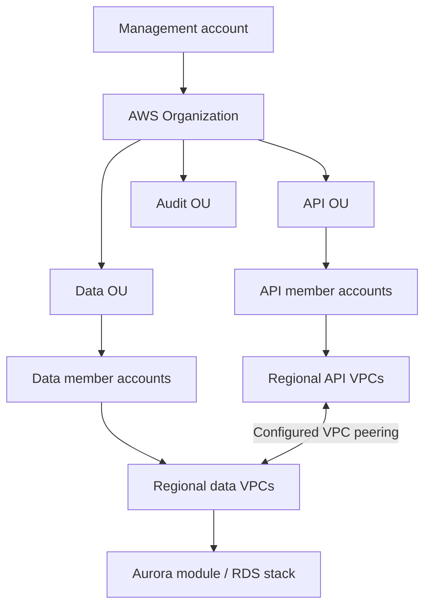
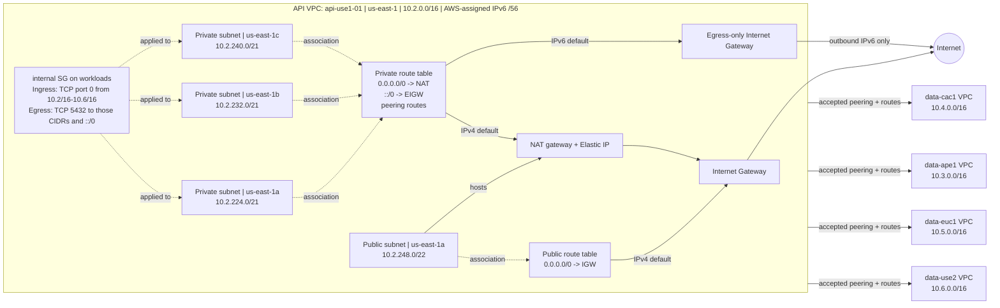
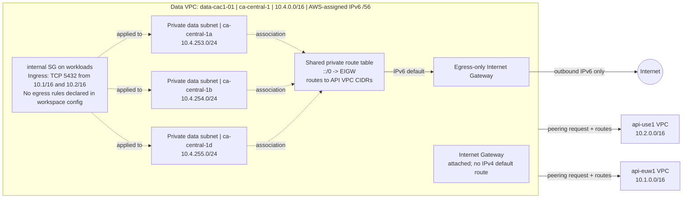

# AWS Infrastructure Design

## Purpose and Scope

This document describes the Terraform-managed AWS infrastructure under `aws/`. The directory contains three root stacks:

- `organization/` manages the AWS Organization, organizational units, member accounts, and per-account region restrictions.
- `vpc/` manages regional VPCs, subnets, route tables, NAT and internet gateways, security groups, and VPC peering.
- `rds/` contains database workspace configuration and a reusable Aurora cluster module. Its root deployment wiring is currently incomplete; see [Current-State Caveats](#current-state-caveats).

The root stacks use Terraform workspaces to select account- and region-specific configuration. The AWS provider is constrained to major version 6 (`~> 6.0`); the VPC and organization roots use an S3 backend configured through workspace HCL files.

## Logical Architecture



The diagram shows the intended layering. The Aurora module is reusable, but its current RDS root stack does not yet derive its inputs from the network state and workspace database configuration.

## Organization and Accounts

The [organization stack](organization/organization.tf) creates an AWS Organization with all features enabled and enables selected service integrations and policy types. It creates three organizational units: `api`, `audit`, and `data`. The current account map in [configs.tf](organization/configs.tf) places the API accounts under `api` and data accounts under `data`; the `audit` OU is currently empty.

| Account | OU | Allowed region in account policy |
| --- | --- | --- |
| `api-euw1` | API | `eu-west-1` |
| `api-use1` | API | `us-east-1` |
| `data-ape1` | Data | `ap-east-1` |
| `data-cac1` | Data | `ca-central-1` |
| `data-euc1` | Data | `eu-central-1` |
| `data-use2` | Data | `us-east-2` |

The stack attaches a region-deny service control policy to every listed account. The policy denies requests outside that account's allowed region, subject to a broad list of `NotAction` exceptions for global or account-level services. Account email addresses are required Terraform inputs. The organization resource has `prevent_destroy` enabled.

The organization provider is fixed to `us-east-1`. Default tags identify Terraform as the provisioner and record the selected workspace. The stack exports created account IDs.

## VPC Network

The [VPC root](vpc/vpc.tf) selects a workspace configuration and instantiates the local VPC module once for each VPC in that configuration. The module creates the VPC and its configured subnets, route tables, subnet associations, NAT gateways, and internet gateways. The root stack separately creates security groups and manages peering requests, acceptances, and associated routes.

### Configured Regional Footprint

The current VPC workspace configuration files define this footprint:

| Workspace | Region | VPC CIDR | IPv6 | Subnets | NAT configuration |
| --- | --- | --- | --- | ---: | --- |
| `api-euw1-vpc` | `eu-west-1` | `10.1.0.0/16` | Enabled | 4: 1 public, 3 private | One NAT gateway in the public subnet; private route table uses it |
| `api-use1-vpc` | `us-east-1` | `10.2.0.0/16` | Enabled | 4: 1 public, 3 private | One NAT gateway in the public subnet; private route table uses it |
| `data-ape1-vpc` | `ap-east-1` | `10.3.0.0/16` | Enabled | 3 private | No NAT gateway configured |
| `data-cac1-vpc` | `ca-central-1` | `10.4.0.0/16` | Enabled | 3 private | No NAT gateway configured |
| `data-euc1-vpc` | `eu-central-1` | `10.5.0.0/16` | Enabled | 3 private | No NAT gateway configured |
| `data-use2-vpc` | `us-east-2` | `10.6.0.0/16` | Enabled | 3 private | No NAT gateway configured |

VPC inputs live under [VPC workspace configurations](vpc/modules/workspace_configs/). IPv4 subnet CIDRs are explicitly configured. When IPv6 is enabled, the VPC requests an AWS-generated IPv6 CIDR and the module divides it into per-subnet prefixes using `cidrsubnet` and the configured `ipv6.bits` value.

### API VPC Example: `api-use1-vpc`

This diagram follows the `api-use1-01` configuration in `us-east-1`. Each private subnet uses the shared private route table; the public subnet has its own public route table and hosts the NAT gateway.



### Data VPC Example: `data-cac1-vpc`

This diagram follows `data-cac1-01` in `ca-central-1`. The three private subnets share one route table. No NAT gateway or IPv4 internet default route is configured; the VPC module still attaches an internet gateway by default, but this route table has no route through it.



### Routing and Egress

- Public route tables receive an IPv4 default route through the VPC internet gateway when internet gateway support is enabled.
- Non-public route tables receive an IPv6 default route through an egress-only internet gateway when IPv6 is enabled.
- NAT gateways are created only for subnets marked for NAT creation. Each receives an Elastic IP. Private route tables list the NAT subnet names used for IPv4 default routes.
- Every configured subnet is associated with its named route table.
- The data VPCs are primarily private. Their workspace configurations do not define NAT gateways, so IPv4 internet egress is not provided by this module configuration.

### Security Groups

The root [security group configuration](vpc/security_groups.tf) creates groups from each VPC's workspace configuration. A shared default `internal` group allows broad private IPv4 traffic within the configured private network ranges and allows outbound traffic; per-VPC settings can override the default. Some data VPC configurations explicitly allow TCP database traffic on port 5432 from API CIDRs. These are configuration-level rules, so review their CIDR and protocol scope before rollout.

### VPC Peering

The [peering resources](vpc/peering.tf) support both sides of cross-account peering: `request` entries create a peering connection and `accept` entries accept an existing connection ID. For each configured connection, the root stack adds IPv4 routes in the VPC's route tables and adds IPv6 routes when an IPv6 destination CIDR is supplied. Peering is not transitive; any additional network path must be configured explicitly.

Peering configuration currently uses static VPC IDs, peer account IDs, CIDRs, and connection IDs in the workspace files. It must be updated when those resources change. The API VPC workspace files accept several existing data VPC peerings, while data VPC request entries selectively control whether requests are enabled.

The VPC root exports VPC IDs and CIDRs, subnet and route-table objects, and peering connection details. These outputs are intended to be consumed by other stacks through remote state.

## Aurora and RDS

The reusable [Aurora module](rds/modules/aurora/README.md) creates a provisioned Aurora MySQL or Aurora PostgreSQL cluster, a DB subnet group, and a configurable number of cluster instances. Callers provide the engine/version, instance class, private subnet IDs, security group IDs, and master username. The module does not create the VPC, database security groups, or network routes.

Important module defaults and outputs:

- Master password management uses AWS Secrets Manager by default; alternatively, callers can supply a sensitive password input.
- Storage encryption, deletion protection, seven-day automated backups, tag copying, and a final snapshot are enabled by default.
- Cluster instances are not publicly accessible.
- Inputs support engine-specific CloudWatch log exports, IAM database authentication, KMS keys, maintenance windows, and tags.
- Outputs include writer and reader endpoints, cluster identifiers/ARN, port, managed secret ARN, and instance identifiers.

The [RDS workspace configuration module](rds/modules/workspace_configs/outputs.tf) selects regional database settings and reads the corresponding VPC state from S3. At present, only `data-cac1-rds` has a database entry; `data-ape1-rds`, `data-euc1-rds`, and `data-use2-rds` contain region values only. The RDS root configuration and its dependency on VPC outputs need to be completed before the Aurora module can be used as an environment deployment.

## Terraform State and Operations

The organization and VPC roots declare an S3 backend. Each has workspace HCL files containing the state bucket, key, and backend region. The root [AWS Makefile](Makefile) provides targets for initialization, planning, applying, workspace selection, validation, and destruction; it selects the workspace and account profile through make variables and passes per-account variable files from `~/tfvars/`.

Typical workflow for an existing VPC workspace:

```sh
make aws/init/vpc aws_account=data-cac1 aws_profile=data-cac1
make aws/plan/vpc aws_account=data-cac1 aws_profile=data-cac1
make aws/apply/vpc aws_account=data-cac1 aws_profile=data-cac1
```

Review the selected workspace, AWS profile, variable file, and plan before applying. Destruction is high impact: organization accounts have `close_on_deletion = true`, and the region SCP is attached to each account. The organization itself is protected from Terraform destruction, but member accounts are not.

## Current-State Caveats

These are observed configuration conditions, not intended architecture:

1. The RDS root [rds.tf](rds/rds.tf) currently uses example subnet/security-group IDs and an `<supported-version>` placeholder, and hard-codes the same cluster identifier and other Aurora inputs inside a `for_each`. It does not map each configured database to its own module inputs.
2. The RDS root declares a VPC remote-state data source, but the current Aurora module call does not use its outputs. The RDS directory also lacks the provider/backend declarations present in the organization and VPC roots, so its standard workspace init workflow needs to be completed.
3. The RDS workspace region lookup for `cac1` contains `ca-central-` rather than `ca-central-1`.
4. The static peering and security-group CIDRs, peer account IDs, and AWS resource IDs should be reviewed against the live environment before applying. Workspace configurations are not a substitute for validating current account ownership and connectivity.

Resolve these items and run a plan for each affected workspace before treating those configurations as deployable.
