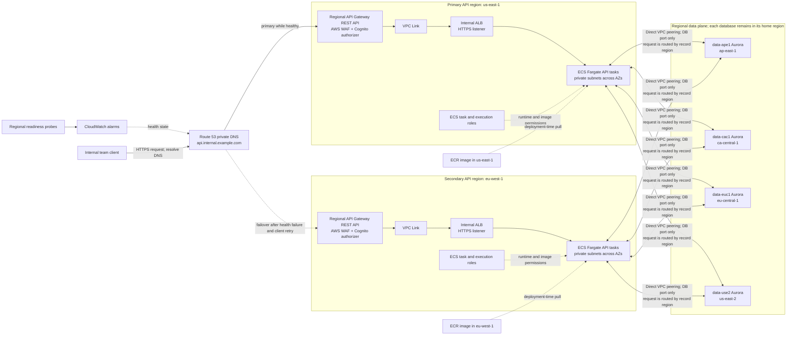

# End-to-End API Request Flow

## Target State

This document describes the intended request path after the multi-region API design is fully wired. It is an architecture target, not a claim that every resource below is currently deployable. See [INFRASTRUCTURE.md](INFRASTRUCTURE.md) for the current infrastructure inventory and implementation caveats.

## Request Lifecycle

1. The client sends an HTTPS request to `api.internal.example.com`. Its resolver uses the private hosted zone associated with the client network.
2. Route 53 returns the primary `us-east-1` API endpoint while its health check is healthy. If that endpoint is unhealthy, the client retries after DNS resolution and receives the `eu-west-1` secondary endpoint. DNS failover does not move an existing TCP connection.
3. The selected regional API Gateway REST API applies AWS WAF rules and validates the caller through a Cognito authorizer. The API validates the user's authorization for the requested tenant, event, and region.
4. API Gateway forwards the request through a regional VPC Link to the internal ALB HTTPS listener. The ALB selects a healthy target in the ECS service.
5. ECS tasks route the database operation using the record's owning region. A read connects to that region's Aurora cluster. A write is sent only to that region's cluster; it is not redirected to a different region's database during API failover.
6. Regional security groups allow only the API task security group to reach the database port. VPC peering and route tables provide the direct network path; peering is non-transitive.
7. The API returns the authorized response to the client. If the response contains regional event data, that response is a cross-region transfer whenever the API task or client is outside the data's home region.
8. The regional readiness probe checks the API path and required dependencies, emits a health signal to CloudWatch, and the alarm-backed Route 53 health check informs DNS failover.

ECR is outside the synchronous request path. During a deployment, the ECS task execution role pulls the selected image digest from the region's ECR repository. Runtime access to application secrets and AWS APIs is granted through the task role, not the execution role.

## Residency and Failover Policy

- Aurora clusters, backups, and snapshots stay in their designated data regions. Do not add cross-region replication unless it is explicitly approved.
- Each record has an owning region. The API uses that region for reads and writes, regardless of which API region Route 53 selected.
- API failover changes where the request is processed; it does not change the data's home region or make cross-region reads residency-neutral.
- Returning event payloads, video, or personal data across a regional boundary is a data transfer. The service must enforce the customer's policy before reading or returning that content. If cross-region transfer is prohibited, use a regional API for that data or return only approved metadata from the central API.
- Centralize only sanitized monitoring signals. Do not put event payloads, video, credentials, or direct identifiers into logs, metrics, traces, or health-check responses.

## Readiness Requirements

The target flow depends on all of the following being implemented and tested:

- A private hosted zone associated with authorized client VPCs or reachable through corporate DNS forwarding.
- Regional API Gateway endpoints with Cognito authorization, WAF, custom domains, and VPC Links.
- Internal ALBs and private ECS tasks in multiple Availability Zones, with healthy target groups.
- Non-overlapping routes and direct peering from both API VPCs to each required data VPC, plus security-group rules limited to the database port and API task sources.
- Route 53 health checks backed by regional readiness probes and CloudWatch alarms. Route 53 checkers cannot directly probe private VPC endpoints.
- Client retry behavior for DNS failover, and tests for API-region loss, database-region loss, stale DNS answers, and residency-denied requests.

The current [ECS/API Gateway configuration](ecs/api_gateway.tf) creates an HTTP API and VPC Link, while the target above uses REST APIs to support the exercise's direct API Gateway WAF requirement. The current [Route 53 records](route53/failover.tf) reference health checks and hosted-zone inputs that still need to be created. ECS-to-data-VPC network paths and application-level region routing also remain to be wired.
